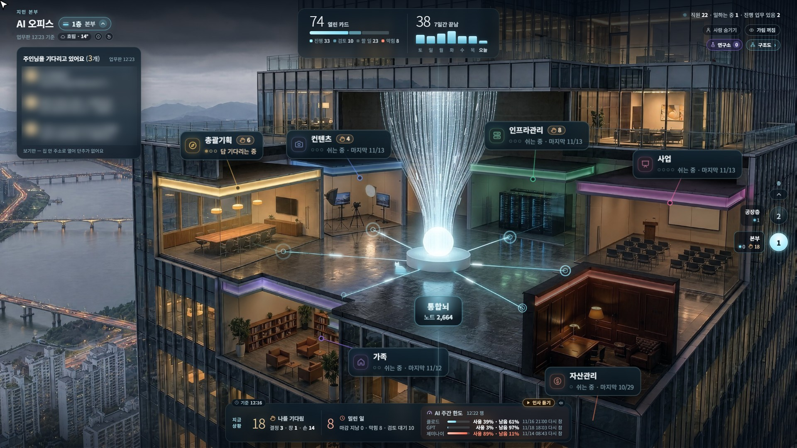
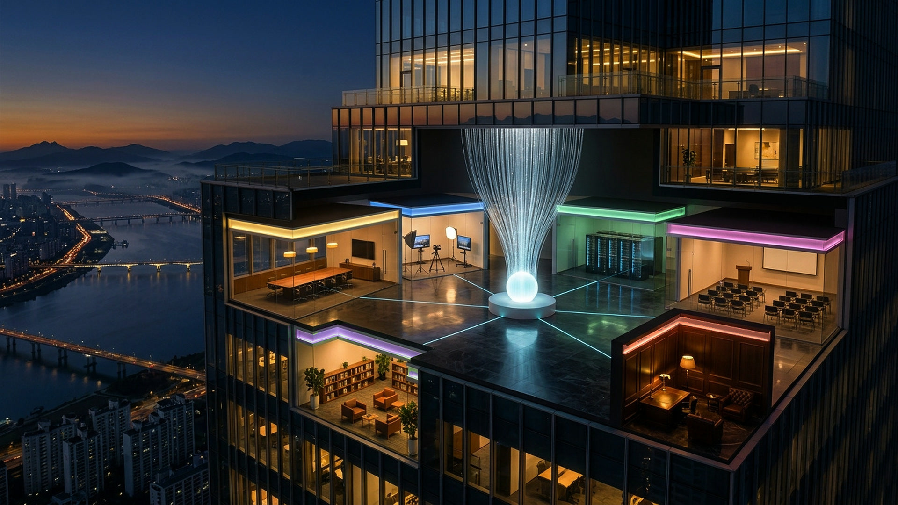

> 릴스 2편 보고 오셨나요? 방마다 AI 직원 한 명, 여러분 버전은 방 두 개로 시작해요.

[1편 안내](/ai-tower/) 5장 '오늘, 하나만 해 봐요'를 먼저 해 주세요. 2편은 그때 만든 `AI활용` 폴더를 이어서 키워요.

저는 컴퓨터를 켜면 크롬이 열리고 이 화면이 열려요.

{: style="width:100%;max-width:900px;border-radius:12px"}

## 1. 방이 뭐예요?

방은 'AI 직원 한 명이 맡을 일 묶음'이에요. AI 창 하나에 이 일 저 일을 다 맡기면 일이 섞여요. 방마다 맡을 일을 정해 두면 창이 자기 일만 해요.

지금 제 사옥에는 AI 직원 22명이 일곱 팀으로 나뉘어 있어요. 방 네 곳만 보면 이래요.

| 방 | 하는 일 |
|---|---|
| 총괄기획 | 제 말 한마디를 일 카드로 쪼개 팀에 나누고, 아침저녁 보고 때 제가 결정할 일만 골라 올려요 |
| 콘텐츠 | 한 주의 글감을 모아 블로그 글과 릴스까지 만들어요. 올리는 단추는 제가 직접 눌러요 |
| 인프라관리 | 서버와 AI 직원들이 멈추지 않게 지키고, 집 스마트홈 고장도 찾아 고칠 방법을 올려요 |
| 연구소 | 매주 AI 직원들이 일한 방식을 돌아보고 더 잘하는 방법을 제안해요. 반영은 제가 확인하고 해요 |

처음부터 이랬던 건 아니에요. 10월 4일에 기획 팀 직원 둘로 이틀 시험해 보고, 10월 6일에 늘렸어요. 그래서 처음부터 방 8개를 만들 필요는 없어요. 1층부터, 방 두 개면 돼요.

## 2. 오늘 해 볼 것: 1편 폴더에 방 두 개 더하기

**다 하면 손에 남는 것:** 창 첫 줄에 "너는 [방 이름] 방이야"라고 쓰면 그 창은 자기 방 일만 하고, 정할 일은 [방 이름]을 붙여 서랍에 넣어요.

### 1단계. 폴더 열기

Claude 앱의 Code 탭에서 `AI활용` 폴더를 열고, 권한 칸을 Accept edits로 두세요.

### 2단계. 요청문 붙여 넣기

AI가 내 일을 다섯 개 안으로 하나씩 묻고, 방 두 개를 골라 줘요. 하나는 '기획' 방, 하나는 내가 가장 자주 하는 일의 방이에요. OK 하면 방 표 파일(방.md)과 규칙이 생겨요. AI가 OK를 서랍에 넣었다고 하면 그 창에 "좋아, 그대로 만들어 줘"라고 답하세요.

<button type="button" onclick="copyBox(this)">요청문 복사</button><pre><code>이 폴더에 1층 방 두 개를 만들어 줘.

먼저 내가 하는 일을 물어봐 줘. 질문은 한 번에 하나씩, 5개 이내로 해 줘. 다 들으면 방 두 개만 골라 줘. 하나는 '기획'(할 일을 나누고 내가 정할 일을 모으는 방)이고, 하나는 내가 가장 자주 하는 일의 방이야. 방을 더 만들자고 권하지 마.

내 OK를 받은 뒤 아래를 만들어 줘.

1. 방.md: 방마다 이름, 맡을 일 두세 가지, 안 하는 일 한 가지를 적는다.
2. CLAUDE.md 에 규칙을 더해 줘. 지금 있는 규칙은 그대로 둬.
   - 창 첫 줄에 "너는 [방 이름] 방이야"라고 하면 방.md 에서 그 방 칸을 읽고, 그 방이 맡은 일만 한다.
   - 다른 방이 할 일이면 직접 하지 말고 서랍.md 에 [그 방 이름]을 붙여 한 줄 넣는다.
   - 서랍에 쓸 때는 줄 맨 앞에 [방 이름]을 붙인다.

다 만들면 방마다 새 창 첫 줄에 붙여 넣을 문장을 한 줄씩 보여 줘.</code></pre>

### 3단계. 방마다 창 열기

왼쪽 목록 맨 위의 새 세션 단추를 누르세요. 새 창의 폴더 칸이 `AI활용`인지 보고, 첫 줄에 AI가 알려 준 문장을 쓰세요. 방마다 창 하나씩이에요.

<button type="button" onclick="copyBox(this)">요청문 복사</button><pre><code>너는 기획 방이야</code></pre>

### 4단계. 됐는지 확인하기

일하는 방 창(예: "너는 상품글 방이야" 창)에 이렇게 보내 보세요.

<button type="button" onclick="copyBox(this)">요청문 복사</button><pre><code>머그컵 소개 글을 세 줄로 써 줘. 다음 주 할인 행사를 열지 말지는 내가 정해야 해.</code></pre>

그 창은 소개 글을 쓰고, 행사 여부는 방 이름을 붙여 서랍에 넣어요. 기획 방 창에서 "서랍 보여 줘"라고 하면 그 줄이 번호로 보이면 성공이에요.

## 3. 잘 안 될 때

- 창이 자기 방을 잊을 때: 그 창에 "방.md 에서 [방 이름] 칸을 다시 읽어 줘"라고 말해 보세요.
- 다른 방 일까지 할 때: 그 창에 "CLAUDE.md 규칙대로 다른 방 일은 서랍에 넣어 줘"라고 말해 보세요.
- 방이 더 필요할 때: 일이 늘어 한 방에 섞이기 시작하면 그때 방을 하나씩 더하세요.

## 4. 다음 편

| 릴스 | 이 폴더에 더하는 것 | 더 보기 |
|---|---|---|
| 3편 | 서랍 세 칸 | [결정 서랍](/ai-tower/drawer/) |
| 4편 | AI들이 같이 쓰는 기억 | [통합뇌](/ai-tower/brain/) |
| 5편 | 정할 일이 먼저 보이는 내 사옥 화면 | [사옥 짓기](/ai-tower/build/) |

## 보너스: 사진 한 장으로 10분 만에 끝내는 드론 오프닝 영상

제가 2026년 10월 20일에 AI 사옥 첫 오프닝을 직접 만든 방법이에요. 파이썬 같은 설치 없이 크롬 브라우저와 사진 한 장만 있으면 10분 만에 만들 수 있어요.

{: style="width:100%;max-width:720px;border-radius:12px"}

[이 사진 받기 (1920x1080)](/assets/images/ai-tower/rooms/flow-start-photo.jpg){: download="ai-tower-photo.jpg"}

**준비물:** 구글 계정, PC 크롬 브라우저, 사진 한 장 (위 타워 사진을 받아 써 보세요).

**왜 거꾸로 만드나요?**
구글 Flow는 시작 장면(start frame)에 넣은 사진을 그대로 지켜 줘요. 사진에서 출발해 멀어지게 만든 뒤 거꾸로 돌리면, 영상 마지막이 내 사진과 딱 맞게 끝나요.

**따라 만들기 7단계**

1. 크롬에서 `labs.google/flow` 주소로 들어가 새 프로젝트를 열어요.
2. 프롬프트 칸의 모델 이름을 눌러 'Video' → 'Frames'를 골라요.
3. '+ Add start frame'(시작 장면)에만 사진을 넣고, 끝 장면('end frame')은 비워 둬요.
4. 설정을 '화면 16:9', '길이 8초', '모델 Veo 3.1 - Fast'로 맞춰요.
5. 아래 복사 상자의 영어 문장을 그대로 붙여 넣고 'Generate'를 눌러요.
6. 사진에서 멀어지는 드론 영상이 나오면 내려받아요.
7. 휴대폰이나 PC의 영상 편집 앱(캡컷 같은 앱)에서 영상을 불러와 '역재생(거꾸로 재생)'으로 뒤집으면 완성이에요!

<button type="button" onclick="copyBox(this)">요청문 복사</button><pre><code>Cinematic aerial drone shot, one continuous move. The shot starts exactly on this frame and holds almost still for a brief moment, then the drone slowly and smoothly pulls back and rises, gliding away from the tower while it keeps looking at the glowing core of the open floor, which stays at the same spot in the frame. The move eases in gently and then keeps a steady, graceful speed to the end. As the camera pulls back, the cut-open office floor becomes smaller, more of the dark glass skyscraper appears above and below it, and more of the dusk river city, the long lit bridges and the misty mountain ridges come into view. By the last frame the open floor fills only about the middle third of the frame. No rotation, no shake, no cuts. The tower, the six rooms and their lights and colors keep exactly the same design; the fiber sculpture keeps glowing softly; city lights twinkle gently. No people anywhere, no birds, no aircraft. No text, captions, logos or watermark. Photorealistic, calm, premium, cinematic, natural motion blur. Sound: faint wind and a distant city hum only.</code></pre>

> **무슨 뜻인가요?** 사진 구도를 그대로 유지하면서 카메라가 부드럽게 뒤로 빠져 도시 전경을 보여 주는 드론 샷으로 만들어 달라는 뜻이에요.

**6단계에서 받은 영상** (Flow가 준 그대로)

<video src="/assets/images/ai-tower/rooms/flow-result-pullback.mp4" poster="/assets/images/ai-tower/rooms/flow-result-pullback.jpg" controls muted playsinline preload="metadata" style="width:100%;max-width:720px;border-radius:12px"></video>

**7단계에서 뒤집은 오프닝**

<video src="/assets/images/ai-tower/rooms/flow-opening-flyin.mp4" poster="/assets/images/ai-tower/rooms/flow-opening-flyin.jpg" controls muted playsinline preload="metadata" style="width:100%;max-width:720px;border-radius:12px"></video>

**알아두면 좋은 점**

- **비용 (2026년 10월 기준):** 구글 무료 계정은 하루 50 크레딧을 받아요. Veo 3.1 - Fast 영상 1개에 20 크레딧이 들어서 하루 두 번쯤 무료로 만들어 볼 수 있어요.
- 완성 영상 오른쪽 아래에는 작은 별 모양 워터마크가 붙어 나와요. 제 예시 영상에도 그대로 있어요.
- **내 사진으로 만들기:** 내 사무실, 가게, 집 사진으로도 똑같이 만들 수 있어요. 사진 속 사람이 움직일 수 있으니 사람이 없는 사진을 쓰면 더 깔끔하게 나와요.
- 내 사진을 쓸 때는 영어 문장 속 건물 설명(tower, open floor, river city 같은 말)을 내 사진에 맞게 바꿔 주세요. AI 앱에 "이 문장을 내 사진에 맞게 고쳐 줘"라고 부탁해도 돼요.

내 사진으로 직접 만들어 본 결과를 댓글이나 DM으로 편하게 보여 주세요!

[← AI 사옥 안내로 돌아가기](/ai-tower/)
