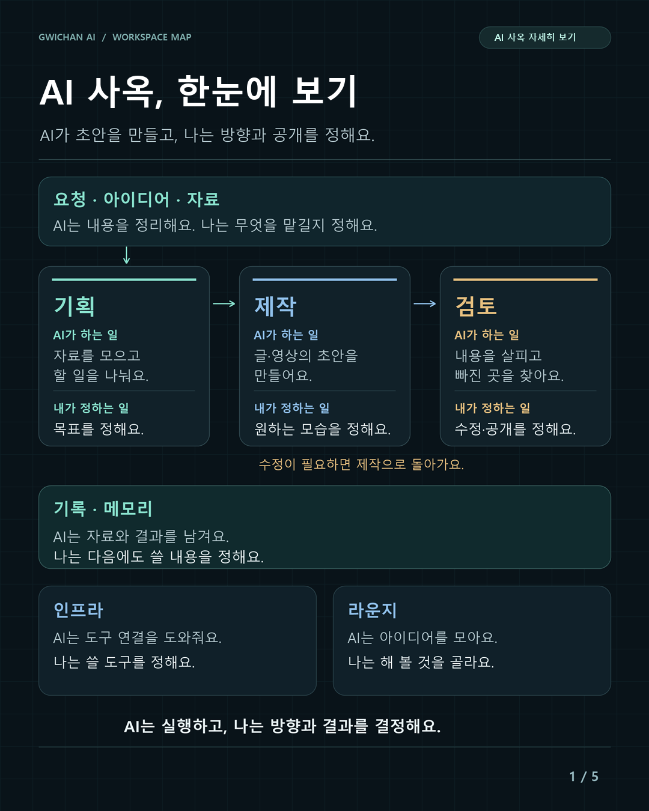
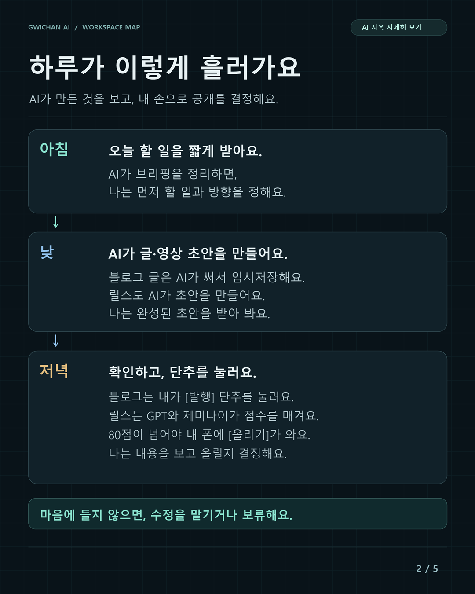
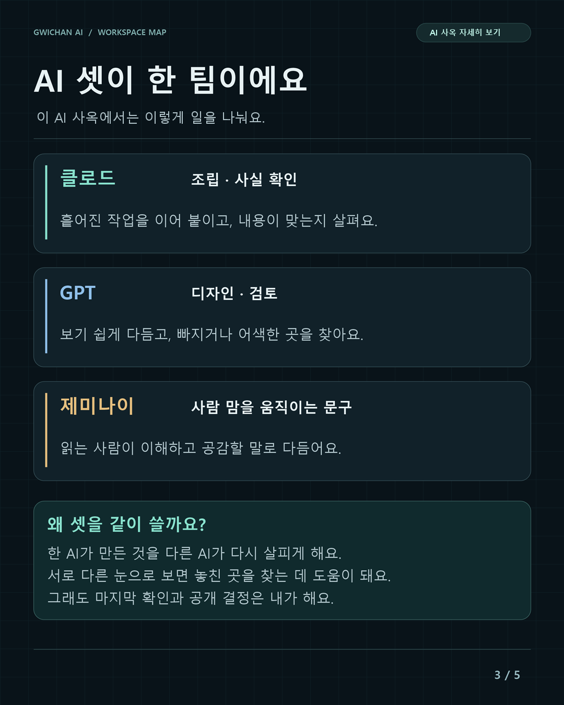
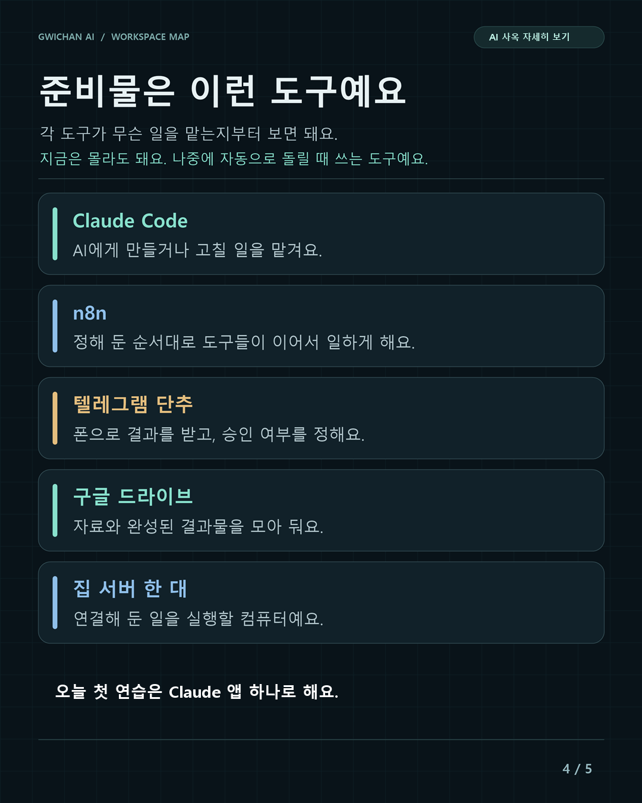
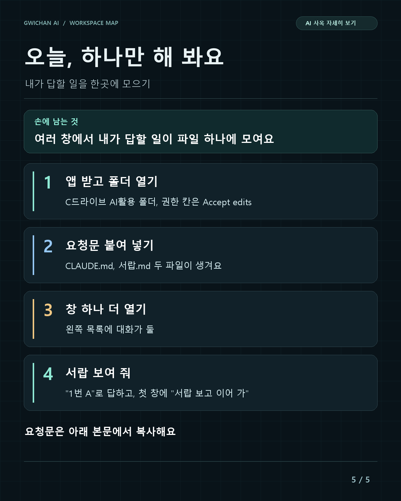

> 릴스 1편 보고 오셨나요? "어디서 뭐가 멈췄는지 놓친 적 없으세요?" 제 이야기예요.

저는 한 달에 AI에 40만원 정도를 써요. 여러 AI를 같이 쓰면서 창을 계속 띄워 둬요. 창마다 일을 맡겨 두고 다른 일을 하다 보면, 어느 창이 제 답을 기다리는지 자꾸 까먹었어요.

제 아이디처럼 귀찮은 걸 싫어하거든요. 제가 일을 찾아서 하는 게 아니라, 일이 저한테 오게 만드는 게 가장 큰 목적이었어요. 그렇게 만든 곳을 저는 'AI 사옥'이라고 불러요. 제가 붙인 이름이에요. 지금은 창이 저를 기다리면 폰으로 알림이 와요. 16일에 152번 왔어요.

## 릴스 시즌 1 · 5부작 안내

- **1편: AI 직원들에게 사옥을 지어 줬다**  
  멈춘 창이 서랍에 모이고, 층을 옮겨도 기억이 이어져요.
- **2편: 방마다 AI 직원 한 명**  
  방마다 무슨 일을 하는지 한 바퀴 둘러봐요. 따라 만드는 안내서는 [여기](/ai-tower/rooms/)에 있어요.
- **3편: 결정할 일만 골라 주는 서랍**  
  수많은 작업 중 내가 결정할 일만 쏙 모아서, 번호 하나로 답해요. 따라 만드는 법은 [여기](/ai-tower/drawer/)에 있어요.
- **4편: 통합뇌, AI 셋이 같은 기억을 쓰는 법**  
  층을 옮겨도, 다른 AI로 넘어가도 기억이 이어지는 비결이에요. 따라 만드는 법은 [여기](/ai-tower/brain/)에 있어요.
- **5편: 이 사옥을 짓는 순서**  
  그림 한 장에서 실제 화면까지, 큰 순서만 보여 드려요. 짓는 순서와 사옥 화면 따라 하기는 [여기](/ai-tower/build/)에 있어요.

자세한 만드는 과정은 네이버 블로그 '빌더 일지'에 차례로 쌓고 있어요.  
👉 https://blog.naver.com/gwichan_ai

릴스 5편은 모두 올라가 있어요. 인스타그램 @gwichan_ai 에서 1편부터 차례로 보실 수 있어요.

---

아래 1~4장은 제 사옥이 돌아가는 모습이고, 5장은 여러분이 오늘 바로 해 볼 수 있는 첫걸음이에요.

## 1. AI 사옥, 한눈에 보기

{: style="width:100%;max-width:540px;border-radius:12px"}

AI가 초안을 만들고, 나는 방향과 공개를 정해요.

| 단계 | AI가 하는 일 | 내가 정하는 일 |
| --- | --- | --- |
| 요청·아이디어·자료 | 내용을 정리해요. | 무엇을 맡길지 정해요. |
| 기획 | 자료를 모으고 할 일을 나눠요. | 목표를 정해요. |
| 제작 | 글·영상의 초안을 만들어요. | 원하는 모습을 정해요. |
| 검토 | 내용을 살피고 빠진 곳을 찾아요. | 수정·공개를 정해요. |
| 기록·메모리 | 자료와 결과를 남겨요. | 다음에도 쓸 내용을 정해요. |
| 인프라 | 도구 연결을 도와줘요. | 쓸 도구를 정해요. |
| 라운지 | 아이디어를 모아요. | 해 볼 것을 골라요. |

수정이 필요하면 제작으로 돌아가요. AI는 실행하고, 나는 방향과 결과를 결정해요.

## 2. 하루가 이렇게 흘러가요

{: style="width:100%;max-width:540px;border-radius:12px"}

AI가 만든 것을 보고, 내 손으로 공개를 결정해요.

**아침 — 오늘 할 일을 짧게 받아요.** AI가 브리핑을 정리하면, 나는 먼저 할 일과 방향을 정해요.

**낮 — AI가 글·영상 초안을 만들어요.** 블로그 글은 AI가 써서 임시저장해요. 릴스도 AI가 초안을 만들어요. 나는 완성된 초안을 받아 봐요.

**저녁 — 확인하고, 단추를 눌러요.** 블로그는 내가 [발행] 단추를 눌러요. 릴스는 GPT와 제미나이가 점수를 매겨요. 80점이 넘어야 내 폰에 [올리기]가 와요. 나는 내용을 보고 올릴지 결정해요.

마음에 들지 않으면, 수정을 맡기거나 보류해요.

## 3. AI 셋이 한 팀이에요

{: style="width:100%;max-width:540px;border-radius:12px"}

이 AI 사옥에서는 이렇게 일을 나눠요.

- **클로드 — 조립·사실 확인:** 흩어진 작업을 이어 붙이고, 내용이 맞는지 살펴요.
- **GPT — 디자인·검토:** 보기 쉽게 다듬고, 빠지거나 어색한 곳을 찾아요.
- **제미나이 — 사람 맘을 움직이는 문구:** 읽는 사람이 이해하고 공감할 말로 다듬어요.

왜 셋을 같이 쓸까요? 한 AI가 만든 것을 다른 AI가 다시 살피게 해요. 서로 다른 눈으로 보면 놓친 곳을 찾는 데 도움이 돼요. 그래도 마지막 확인과 공개 결정은 내가 해요.

## 4. 준비물은 이런 도구예요

{: style="width:100%;max-width:540px;border-radius:12px"}

각 도구가 무슨 일을 맡는지부터 보면 돼요.

지금은 몰라도 돼요. 나중에 자동으로 돌릴 때 쓰는 도구예요.

| 도구 | 맡는 일 |
| --- | --- |
| Claude Code | AI에게 만들거나 고칠 일을 맡겨요. |
| n8n | 정해 둔 순서대로 도구들이 이어서 일하게 해요. |
| 텔레그램 단추 | 폰으로 결과를 받고, 승인 여부를 정해요. |
| 구글 드라이브 | 자료와 완성된 결과물을 모아 둬요. |
| 집 서버 한 대 | 연결해 둔 일을 실행할 컴퓨터예요. |

오늘 첫 연습은 Claude 앱 하나로 해요.

## 5. 오늘, 하나만 해 봐요: 내가 답할 일을 한곳에 모으기

{: style="width:100%;max-width:540px;border-radius:12px"}

처음부터 다 갖출 필요 없어요. 저도 AI 직원 둘로 시작했어요. 창 두 개면 돼요.

**다 하면 손에 남는 것:** 여러 창에서 내가 답할 일이 파일 하나에 모여요. "서랍 보여 줘" 한마디면 번호로 보이고, 번호로 답해요.

**준비물:** Claude 앱(데스크톱), Pro 이상 유료 구독. 아래에서 '창'은 Claude 앱의 Code 탭에서 여는 대화 하나를 말해요.

#### 1단계. 앱 받고 폴더 열기

[claude.ai/download](https://claude.ai/download)에서 앱을 받아 로그인하세요. C드라이브에 `AI활용` 폴더를 하나 만드세요(윈도우 기준이에요. 맥은 문서 폴더에 만드세요). 앞으로 AI 일은 이 폴더 안에서 해요.

앱의 Code 탭에서 입력창 아래 폴더 칸을 누르고, Open folder로 `AI활용` 폴더를 고르세요. 그 옆 권한 칸은 Accept edits로 바꾸세요. AI가 파일을 만들 때마다 멈춰서 묻지 않아요.

#### 2단계. 요청문 붙여 넣기

그 창에 아래 요청문을 붙여 넣으세요. 처음 한 번은 파일을 만들어도 되냐고 물을 수 있어요. 허용을 누르세요.

<button type="button" onclick="copyBox(this)">요청문 복사</button><pre><code>이 폴더에서 Claude 앱 Code 탭의 창 여러 개를 같이 쓸 거야. 내가 답할 일만 한곳에 모이게 해 줘.

아래 파일을 만들어 줘.

1. CLAUDE.md (모든 창이 같이 읽는 규칙)
   - 내가 결정하거나 직접 해야 하는 일이 생기면 대화창에서 묻지 말고 서랍.md 맨 아래에 한 줄을 쓴다. 꼴은 "- [ ] 할 일 / 추천안 / 이유". 대화창에는 "서랍에 넣었어요"라고만 알리고, 답을 기다리지 말고 할 수 있는 다른 일을 한다.
   - 돈이 나가는 일, 밖으로 보내는 일, 되돌릴 수 없는 일은 서랍.md 에 넣고 내 답이 올 때까지 하지 않는다.
   - 일을 시작하거나 이어 갈 때 서랍.md 에서 내가 체크한 줄을 먼저 읽고, 그 답대로 이어 간다.
   - 내가 "서랍 보여 줘"라고 하면 서랍.md 에서 아직 안 끝난 줄을 번호로 보여 준다. 내가 "1번 A"처럼 답하면 그 줄의 [ ]를 [x]로 바꾼다.
2. 서랍.md: 제목 한 줄만 있는 파일

다 만들면 "준비됐어요"라고 말해 줘.</code></pre>

"준비됐어요"나 비슷한 말이 나오면 탐색기에서 `AI활용` 폴더를 열어 보세요. CLAUDE.md와 서랍.md 두 파일이 보이면 됐어요(확장자가 숨겨져 있으면 CLAUDE, 서랍으로 보여요).

AI가 "열려 있던 창은 새로 열어야 해요"라고 해도 이 첫 창은 그대로 쓰세요. 규칙을 방금 직접 써서 알고 있어요.

#### 3단계. 창 하나 더 열기

왼쪽 목록 맨 위의 새 세션 단추를 누르세요. 새 창의 폴더 칸이 `AI활용`이 아니면 다시 고르고, 권한 칸도 Accept edits로 바꾸세요. 창이 옆에 나란히 뜨지는 않아요. 화면은 하나이고, 왼쪽 목록에 대화가 둘 생겨요. 목록에서 눌러 오가면 돼요. 이제 창마다 다른 일을 맡기면 돼요. 보고 있지 않은 창이 일을 끝내면 앱이 컴퓨터 알림을 띄워 줘요.

#### 4단계. 됐는지 확인하기

첫 창에 이렇게 보내고, 답을 다 쓸 때까지 기다리세요.

<button type="button" onclick="copyBox(this)">요청문 복사</button><pre><code>우리 가게 인스타 첫 글의 제목 후보 두 개를 만들어 줘. 어느 쪽을 쓸지는 내가 골라야 해. 고르면 그 제목으로 소개 글 세 줄을 써 줘.</code></pre>

첫 창은 "서랍에 넣었어요"라고만 해요. 정상이에요.

그다음 다른 창에 "서랍 보여 줘"라고 쓰세요. 첫 창에서 맡긴 일이 번호로 보이면 성공이에요. 서랍을 본 그 창에 "1번 A"처럼 답하면, 서랍.md 의 그 줄이 [ ]에서 [x]로 바뀌어요. 첫 창으로 돌아가 "서랍 보고 이어 가"라고 하면 고른 답으로 계속해요. 창이 많아질수록 차이가 커져요. 창을 하나씩 열어 보지 않고 서랍만 보면 돼요.

#### 잘 안 될 때

- 서랍에 안 쌓일 때: 일을 맡긴 그 창에 "CLAUDE.md 규칙대로 내가 정할 일을 서랍.md 에 적어 줘"라고 말해 보세요.

## 릴스에서 본 것, 다음은

| 릴스 | 볼 수 있는 것 | 더 보기 |
|---|---|---|
| 2편 | 방마다 AI 직원 한 명 | [방 만드는 법](/ai-tower/rooms/) |
| 3편 | 내가 결정할 일만 모으기 | [결정 서랍](/ai-tower/drawer/) |
| 4편 | AI들이 같은 기억 쓰기 | [통합뇌](/ai-tower/brain/) |
| 5편 | 사옥을 짓는 순서 | [사옥 짓기](/ai-tower/build/) |
